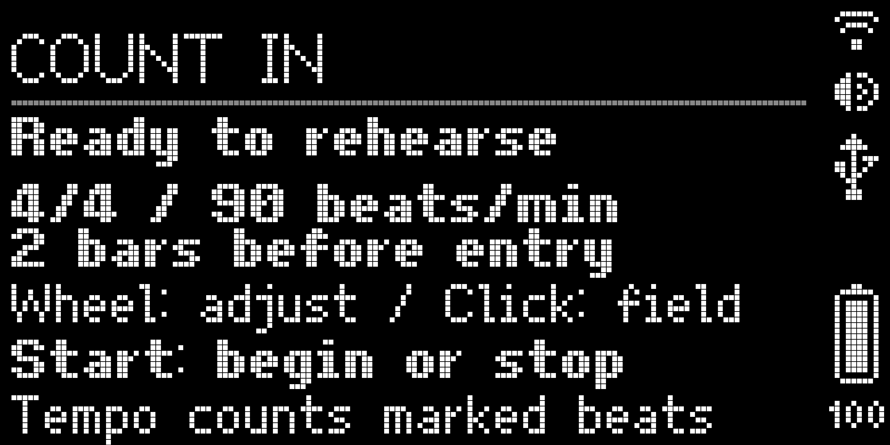

# Count In

Count silent bars at your tempo and show the exact beat where you should enter.

Put a silent count-in where the ensemble can see it. The bars and meter determine exactly how many pulses pass before the entrance, with no click track leaking into the room recording.

## Screen transitions

Choose the meter, set the lead-in and start the count. The beat marks carry the entrance.


<details>

<summary>Watch the rear display</summary>



</details>

## Set the meter and lead-in

1. Turn the wheel on **TEMPO** to select the pulse rate. Click to choose **BARS** and turn to set the length.
2. Click again for **METER**. Choose 2/4, 3/4, 4/4 or 6/8. In 6/8 each marked beat is one eighth note.
3. Read the full setup on the rear before beginning. The recording reduces the count to one bar and selects 3/4.


## Make the entrance

1. Press **Start**. The front labels the current bar and beat; a highlighted block moves to the next beat in time.
2. After the last silent beat the display changes to **GO / PLAY**. The clip shows the three-beat count leading up to that entrance.
3. Press **Start** to stop a count early or begin another. Adjust settings between runs.


## Example from the emulator

At 90 marked beats per minute, one beat lasts two-thirds of a second. A one-bar count in 3/4 therefore lasts two seconds. Two bars at the same tempo would last four seconds. The number of blocks follows the selected meter.

## Run in the emulator

Open BUSY Bar Emulator. From this repository, run:

```sh
~/.busy-emulator/bin/busy-emulator dev --once
```

Press **Back** to exit.

The GIFs are excerpts from the emulator recording. Each LED occupies a 16 × 16 cell with a black border. The end frames pause for reading.

[Full recording](media/controls.mp4) · [Rear display](screenshots/back-1.png) · [Firmware test](EMULATOR-QA.md) · [MIT license](LICENSE)
